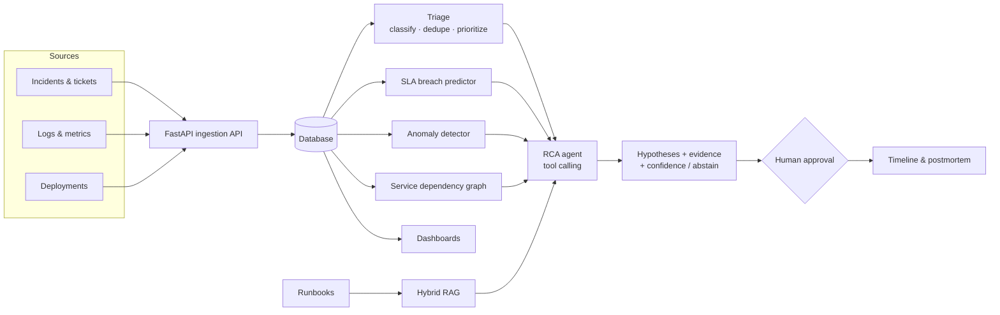

# Incident Intelligence Platform

**An AI copilot for IT operations.** It ingests incidents, user tickets, application logs and metrics, then triages them, predicts SLA breaches, detects anomalies, retrieves the right runbooks and proposes **evidence-linked root-cause hypotheses** — with a human approving every remediation.

> Status: **Step 1 of 15 complete** (foundations). Built step by step in public; see the [roadmap](docs/ROADMAP.md) and the [learning journal](docs/learning/).

---

## Why this project

On-call engineers lose the first 30+ minutes of an outage to the same chores: finding duplicate tickets, working out which service is actually broken, checking what was deployed recently, digging through logs and hunting for the right runbook. This platform automates that investigation and hands the engineer a ranked, cited shortlist of likely causes and safe next steps.

## What it does

| Capability | AI / technique | Status |
|---|---|---|
| Classify, deduplicate and prioritize incidents | ML baseline → embeddings → LLM, cosine similarity | Planned (Step 5) |
| Predict SLA breaches | Gradient boosting, probability calibration | Planned (Step 6) |
| Detect anomalies in logs and metrics | Rolling z-score / MAD, STL, Isolation Forest, log template mining | Planned (Step 7) |
| Connect incidents to services and recent deployments | Service-dependency knowledge graph | Planned (Step 8) |
| Retrieve troubleshooting runbooks | Hybrid RAG (BM25 + vectors + rank fusion) | Planned (Step 9) |
| Evidence-linked root-cause hypotheses | LLM agent with tool calling, confidence scoring and abstention | Planned (Step 10) |
| Remediation that requires human approval | Approval workflow + audit log | Planned (Step 11) |
| Incident timelines and postmortems | Grounded LLM generation with citations | Planned (Step 12) |
| Incident, SLA and service-health dashboards | Streamlit | Planned (Step 13) |
| Measured quality | Evaluation harness on seeded incidents | Planned (Step 14) |

## Architecture



## Tech stack

| Layer | Choice | Why |
|---|---|---|
| Language & tooling | Python 3.12, [uv](https://docs.astral.sh/uv/), Ruff, pytest | Fast, reproducible installs; one tool for Python, venvs and dependencies |
| API | FastAPI + Pydantic | Type-checked requests/responses, automatic OpenAPI docs |
| LLM | Any OpenAI-compatible endpoint; default **Ollama + Qwen3 8B** running locally | Free, private (incident data stays on the machine), swappable to Groq/Gemini |
| Embeddings | `nomic-embed-text` via Ollama | Free local embeddings for dedup and RAG |
| ML / time series | scikit-learn, pandas, statsmodels | Strong, explainable baselines before reaching for an LLM |
| Graph | NetworkX | Service dependencies, blast radius, upstream-cause search |
| UI | Streamlit | Dashboards in pure Python |
| CI | GitHub Actions | Lint + tests on every push |

## Quickstart

First-time Mac setup (Homebrew, uv, Ollama): see [docs/SETUP_MAC.md](docs/SETUP_MAC.md).

```bash
cp .env.example .env                 # local settings (never committed)
uv sync                              # install Python 3.12 + dependencies
uv run pytest                        # run the tests
uv run python scripts/check_llm.py   # confirm the LLM answers
uv run uvicorn incident_intel.api.main:app --reload
# open http://127.0.0.1:8000/docs
```

## Project structure

```
├── src/incident_intel/      # the application package
│   ├── api/main.py          # FastAPI app and endpoints
│   └── config.py            # typed settings from env vars / .env
├── scripts/check_llm.py     # smoke test for the LLM connection
├── tests/                   # pytest test suite
├── docs/                    # roadmap, setup guides, learning journal
└── .github/workflows/ci.yml # CI: lint + tests on every push
```

## Roadmap

15 steps from empty folder to evaluated, demo-ready platform: **[docs/ROADMAP.md](docs/ROADMAP.md)**.

## License

[MIT](LICENSE)
