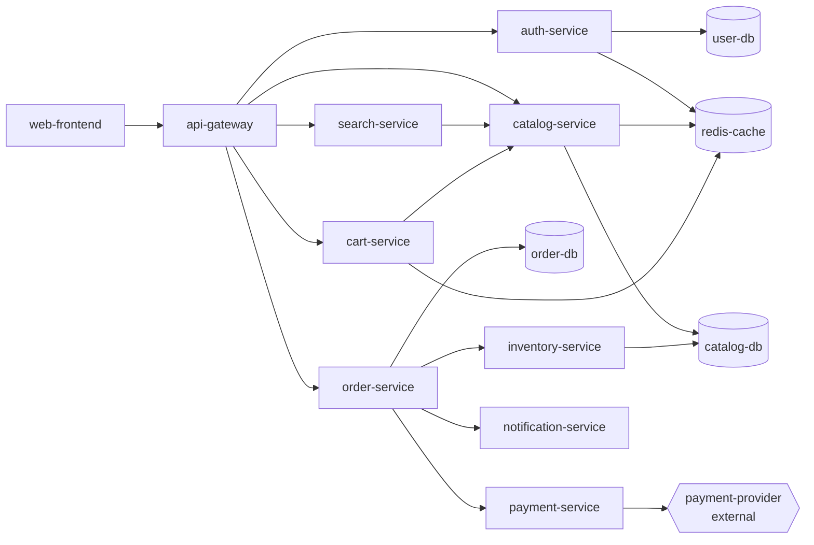

# Synthetic data: ShopFast

Real incident data is private and, worse, unlabeled: nobody wrote down the true root cause of every alert. So the platform is developed against **ShopFast**, a fictional e-commerce company whose outages we plant ourselves. Because we planted them, we know the right answers, and every AI component can be scored against them (Step 14).

Generate the data:

```bash
uv run python scripts/generate_data.py
```

Options: `--days 14 --incidents 12 --seed 42 --out data/synthetic`. The same seed always produces byte-identical files, so the data is not committed to git; anyone can regenerate it.

Then load it into the database (`data/incident_intel.db`, replaced on every run) so the API can serve it:

```bash
uv run python scripts/load_data.py
```

Every file is loaded except `ground_truth.json`: the platform must never see the answers it is evaluated on.

## The company



An arrow means "calls". When a box breaks, everything with an arrow path *into* it feels the pain. That's why the loudest alert is often not on the broken service.

## Files

| File | Format | One record is… |
|---|---|---|
| `services.json` | JSON list | a service: `name`, `tier`, `team`, `criticality`, `depends_on` |
| `deployments.jsonl` | JSON Lines | a release: `id`, `service`, `version`, `deployed_at`, `author`, `change_summary`, `status`, `rolled_back_at` |
| `metrics.csv` | CSV | one measurement: `timestamp`, `service`, `metric`, `value` (every 5 minutes) |
| `logs.jsonl` | JSON Lines | a log line: `timestamp`, `service`, `level`, `message`, `trace_id` |
| `incidents.jsonl` | JSON Lines | a monitoring alert: `id`, `opened_at`, `service`, `title`, `priority`, `alert_metric`, `observed_value`, `threshold`, `resolved_at` |
| `tickets.jsonl` | JSON Lines | a human report: `id`, `created_at`, `reporter`, `channel`, `subject`, `body`, `category`, `priority`, `resolved_at` |
| `ground_truth.json` | JSON | the answers (see below). **Never shown to the AI**; used only for evaluation |

Metrics: `request_rate` (req/s), `error_rate` (0–1), `latency_p95_ms`, `cpu_pct`, `memory_pct`. The external `payment-provider` has no CPU/memory (we can't see inside a third party).

## What's planted

| Root cause | Where | What it looks like |
|---|---|---|
| `bad_deployment` | a backend service | errors start exactly at a deploy, stop at the rollback |
| `db_connection_pool_exhaustion` | a database | clients' latency explodes; "too many clients" / pool timeout logs |
| `third_party_outage` | payment-provider | payment-service errors and timeouts; nothing internal changed |
| `cache_memory_pressure` | redis-cache | memory climbs for 30–60 min **before** users notice; logouts and lost carts |

And the noise around them, which makes the problem realistic:

- **Routine deployments** (2–5 per day) that break nothing.
- **Decoy deployments**: innocent releases planted 10–45 minutes before some incidents, to catch systems that blame every recent change.
- **False alarms**: CPU spikes that trigger an alert and clear by themselves.
- **Routine tickets**: password resets, refund questions, VPN problems.
- **Messy text**: lower-case, missing punctuation, typos, "pls help".

## Ground truth

`ground_truth.json` → `seeded_incidents`, one record per planted incident:

| Field | Used later to evaluate… |
|---|---|
| `root_cause`, `root_cause_service` | the RCA agent's top hypothesis (Step 10) |
| `incident_ids`, `ticket_ids` | grouping and de-duplication (Step 5) |
| `priority` | prioritization (Step 5) |
| `affected_services` | blast-radius estimation (Step 8) |
| `trigger_deployment_id` / `decoy_deployment_ids` | deployment correlation without false blame (Step 8) |
| `started_at`, `ended_at` | anomaly detection timing (Step 7) |
| `expected_runbook` | runbook retrieval (Step 9) |
| `remediation`, `summary` | remediation and postmortem quality (Steps 11–12) |

Plus `false_alarm_incident_ids`: alerts that belong to no real incident.
